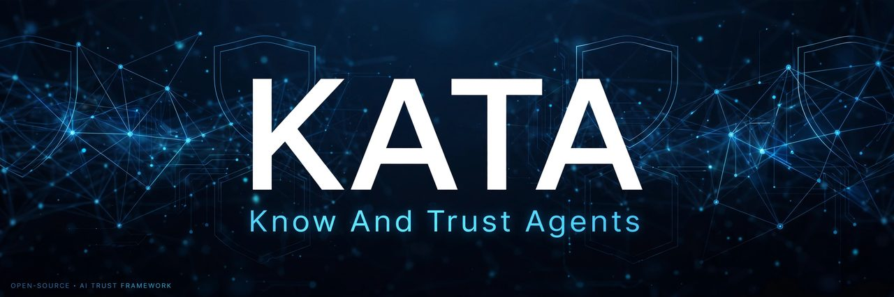
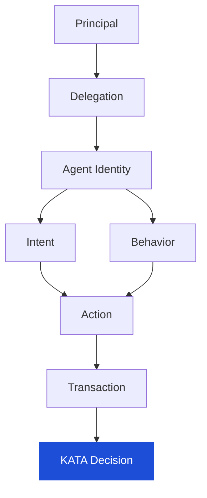
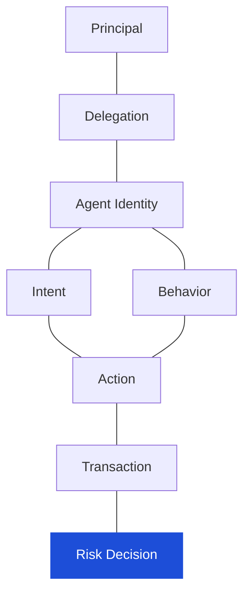

<div align="center">



[](KATA.md)
[](LICENSE)
[](https://github.com/kaanuluer/KATA/pulls)

# KATA

## Know And Trust Agents

> **KATA is a framework for knowing who an AI agent is, who authorized it, what it was intended to do, how it is behaving, and whether the action it is about to take should be trusted.**

</div>

---

## Why KATA exists

Traditional digital systems assume a simple chain:

```
Human → Authentication → Authorization → Transaction
```

They ask: *"Is this user authenticated?"* Then: *"Is this user authorized?"*

In an agentic world, that model breaks. A human authenticates — and then an **AI agent** acts on their behalf. Consider:

> You tell an assistant: **"Book me a flight to Toronto next weekend for less than CAD 500."**

The agent may search airlines, compare prices, enter passenger details, use your payment method, purchase the ticket, and modify the booking. Every one of those steps is an action you didn't directly take.

The question is no longer just *"Is the user authenticated?"*

It becomes:

> **"Is this agent authorized to perform this specific action, and does the action match the user's original intent?"**

KATA is an open framework for answering exactly that.

## The four fundamental questions

KATA is built on four questions that traditional auth never asks:

| # | Question | What it verifies |
|---|----------|------------------|
| 1 | **WHO** is the agent? | Identity and provenance of the agent |
| 2 | **WHO** authorized the agent? | The principal↔agent delegation relationship |
| 3 | **WHAT** was the agent authorized to do? | Original intent, scope, limits, constraints |
| 4 | **IS THE AGENT** behaving consistently with that authorization? | Behavior and action vs. declared intent, including price and counterparty terms |

Sardine's 2026 report describes a Know Your Agent (KYA) layer with four jobs: tell that the caller is a bot, check that it is authorized for a verified user, detect agent spoofing, and check that it stays inside a declared scope. Those jobs line up with Q1–Q4. KATA asks for a signed delegation and a signed structured intent, then a behavior check, and it keeps the decision record a cardholder can point at when they say they did not authorize the charge. The mapping is in [KATA.md](KATA.md#know-your-agent-kya).

## Core vs. optional

An implementation needs the core. Profiles and related work are optional.

**Core (required).** The four questions above. The intent and delegation schemas ([`schemas/intent.json`](schemas/intent.json), [`schemas/delegation.json`](schemas/delegation.json)), and the signed intent agreement that binds an intent to an agent ([`schemas/intent-mandate.json`](schemas/intent-mandate.json), [`schemas/agreement.json`](schemas/agreement.json)). The seven [decision outcomes](#decision-model).

**Profiles / extensions (optional).** Use-case examples — payments, MCP or other tool calls, checkout — in [`examples/`](examples/).

**Related work.** External references that position KATA. They add no question, schema, or decision.

- [Sardine, *Rethinking Fraud Prevention for Agentic Commerce*](https://www.sardine.ai/whitepapers/rethinking-fraud-prevention-for-agentic-commerce) (2026). The Know Your Agent mapping is in [KATA.md](KATA.md#know-your-agent-kya).
- [Darwinium press release, 8 October 2026](https://rss.globenewswire.com/news-release/2026/10/08/3377318/0/en/darwinium-puts-intent-intelligence-at-the-center-of-fraud-prevention-for-ai-agents-humans-and-bots.html). Intent Intelligence infers intent from behavior. Journey Transition Probability compares the order and timing of steps with typical behavior. MCP Protection ties an agent's MCP tool calls to that journey, verifies agent credentials, and can require a step-up before a payment. Darwinium reports that about one in four agentic transactions on its network self-declare. Darwinium infers intent from the path. KATA records a signed intent and measures behavior against that record. The one-in-four figure is Darwinium's.
- [AgentCommerceBench](https://github.com/BuildWithGordonAI/agentcommercebench) (BuildWithGordonAI, Apache-2.0). A later evaluation set, not a coverage claim. See [Evaluation](#evaluation).

## Core trust model



Each layer adds context. KATA never makes a trust decision on a single signal — it evaluates the **complete relationship** between these objects.

## The KATA risk graph

Trust is not a linear pipeline. It's a connected graph where signals are correlated, not scored in isolation:



> **A single signal may not indicate fraud. Multiple connected signals may.**

## Intent as a first-class signal

Traditional fraud systems focus on the transaction. KATA treats **intent** as a first-class risk signal — and intent should be structured, machine-readable data:

```json
{
  "purpose": "purchase",
  "category": "electronics",
  "maximum_amount": 1500,
  "currency": "CAD",
  "merchant_constraints": [],
  "time_limit": "2026-10-10",
  "allowed_actions": ["search", "compare", "purchase"]
}
```

KATA continuously measures the **distance between declared intent and observed action**:

| | Intent | Observed action | Match |
|---|---|---|---|
| Shopping agent | Max CAD 1,500 laptop | CAD 4,200 MacBook Pro | ❌ Failed → **BLOCK** |
| Shopping agent | Max CAD 1,500 laptop | CAD 1,300 laptop at the quoted and listed price | ✅ OK → **ALLOW** |
| Shopping agent | Max CAD 1,500; quoted and listed CAD 1,000 | CAD 1,300 charge, undisclosed fee | ❌ Under the ceiling, still not OK → **BLOCK** |

**Valid identity + valid authorization ≠ valid action.**

**Amount under the ceiling ≠ a price that matches the quote.** A genuine merchant can be the party that takes the extra value. The CAD 1,300 row is `ALLOW` only when quote, list, and fees agree. The worked counterparty case is [`examples/price-integrity/`](examples/price-integrity/).

## Decision model

KATA decisions are not limited to allow/block. The framework proposes seven graduated outcomes:

| Decision | Meaning |
|---|---|
| `ALLOW` | Identity, delegation, intent, behavior, and action are consistent |
| `ALLOW_WITH_MONITORING` | Risk is elevated but acceptable — proceed with enhanced monitoring |
| `STEP_UP` | Additional verification is required before the action completes |
| `HUMAN_APPROVAL` | The agent cannot complete the action alone — a human must approve |
| `BLOCK` | The action violates policy or exceeds risk tolerance |
| `REVOKE` | The previously granted delegation is no longer valid |
| `QUARANTINE` | The agent is temporarily restricted pending investigation |

Trust is **dynamic and continuous** — an agent trusted five minutes ago may become untrusted if its behavior, scope, infrastructure, or intent drifts.

The same seven outcomes cover a cheating counterparty. `BLOCK` stops a charge that breaks the quote or the fee policy. `REVOKE` is for the delegation, not for the merchant.

## Traditional fraud vs. agentic fraud

KATA extends existing fraud intelligence into the agentic world instead of reinventing it:

| Traditional fraud | Agentic equivalent |
|---|---|
| User identity | Principal identity |
| Device identity | Agent identity |
| Device reputation | Agent reputation |
| IP reputation | Agent infrastructure reputation |
| Behavioral biometrics | Agent behavioral profile |
| Account linkage | Principal-agent-entity graph |
| Transaction velocity | Agent action velocity |
| Authentication | Delegation verification |
| Authorization | Scope / intent verification |
| Transaction risk | Intent / action risk |
| Session risk | Agent session risk |
| Merchant risk | Agent / merchant interaction risk |

**But not every signal survives the move unchanged.** Fraud research groups them three ways:

| Shift | Signals |
|---|---|
| Weaken | IP address, device intelligence, cookies — the agent runs in a cloud, not a hand |
| Strengthen | Phone (step-up must reach the human), address (shipping is an anchor), identity proofing, agent-behavior profiling |
| Hold steady | Email, payment instrument, bank account |

Net effect: **assessment shifts from device trust to delegation trust** — *is this agent legitimate, and does this action match the grant?*

See [research/fraud-signals.md](research/fraud-signals.md) for the expanded mapping.

## API concept

```http
POST /kata/evaluate
```

Request:

```json
{
  "principal": { "type": "human", "id": "usr_9182" },
  "agent":     { "agent_id": "shopper-01", "provider": "acme-ai", "model": "acme-2.1" },
  "delegation":{ "delegation_id": "dlg_77", "expires_at": "2026-10-10T23:59:59Z", "scope": "shopping" },
  "intent":    { "purpose": "purchase", "maximum_amount": 1500, "currency": "CAD" },
  "action":    { "action_type": "purchase", "amount": 4200, "currency": "CAD", "item": "MacBook Pro" },
  "context":   { "merchant": "techstore.example", "timestamp": "2026-10-04T14:02:11Z" }
}
```

Response:

```json
{
  "decision": "BLOCK",
  "risk_score": 94,
  "reasons": ["ACTION_EXCEEDS_INTENT", "DELEGATION_SCOPE_MISMATCH"],
  "required_action": "HUMAN_APPROVAL"
}
```

This is conceptual — the framework will eventually define formal schemas and APIs. Draft schemas already live in [`schemas/`](schemas/).

## What's next · Roadmap

- [ ] Formal JSON Schemas — *drafted, see [`schemas/`](schemas/)*
- [x] Intent agreement — *signed mandate, lifecycle, and action check, see [docs/intent-agreement.md](docs/intent-agreement.md) and [`reference/python`](reference/python)*
- [ ] Reference evaluation implementation (full seven-outcome engine: identity, behavior, risk score)
- [ ] Threat model — *drafted, see [docs/threat-model.md](docs/threat-model.md)*
- [ ] Intent schema & natural-language intent capture guidance — *price, fees, and counterparty drafted; the signed agreement is specified*
- [ ] Delegation lifecycle & revocation protocol concepts — *intent-agreement revocation is drafted; distribution is not*
- [ ] Example evaluations — *drafted, see [`examples/`](examples/)*
- [ ] Interoperability notes for verifiable credentials & agent protocols — *drafted, see [docs/interoperability.md](docs/interoperability.md)*
- [ ] External evaluation — *not started. The intent check exists; the benchmark run waits on the classes that check can see, and on the classes it cannot*

### Evaluation

KATA does not claim measured coverage. The class table in [docs/threat-model.md](docs/threat-model.md) is a design comparison with [AgentCommerceBench](https://github.com/BuildWithGordonAI/agentcommercebench) (BuildWithGordonAI, Apache-2.0), not a result.

Once a reference implementation exists, evaluate it against the [AgentCommerceBench dataset](https://huggingface.co/datasets/dpaul93/agentcommercebench) (`dpaul93/agentcommercebench`): the `benchmark` config holds 1,000 sessions (25 of each of the 20 classes, plus 500 clean), and `production` holds 30 de-identified settled actions. Report recall at a stated false-positive budget, per class, and name the classes the implementation cannot see. Silent downgrade (F6), in particular, needs delivery evidence the payment itself does not carry. Until that run exists, do not cite a coverage number.

## Docs & schemas

| Area | Document |
|---|---|
| Full framework | [KATA.md](KATA.md) |
| Architecture | [docs/architecture.md](docs/architecture.md) |
| Threat model | [docs/threat-model.md](docs/threat-model.md) |
| Risk model | [docs/risk-model.md](docs/risk-model.md) |
| Intent model | [docs/intent-model.md](docs/intent-model.md) |
| Intent agreement | [docs/intent-agreement.md](docs/intent-agreement.md) — signed mandate, lifecycle, action check |
| Delegation model | [docs/delegation-model.md](docs/delegation-model.md) |
| Agent identity | [docs/agent-identity.md](docs/agent-identity.md) |
| Schemas | [schemas/](schemas/) — `agent`, `delegation`, `intent`, `intent-mandate`, `agreement`, `action`, `decision` |
| Reference library | [`reference/python`](reference/python) — sign a mandate, verify it, evaluate an action |
| Interoperability | [docs/interoperability.md](docs/interoperability.md) — Verifiable Intent, AP2 v0.2 (and the v0.1 Intent/Cart/Payment names), Visa TAP, AGNTCY |
| Examples | [examples/](examples/) — `shopping-agent`, `price-integrity`, `payment-agent`, `banking-agent`, `ucp-checkout` (UCP sketch), `verifiable-intent`, `ap2-checkout` |
| Research | [research/fraud-signals.md](research/fraud-signals.md), [research/standards.md](research/standards.md) |
| Changelog | [CHANGELOG.md](CHANGELOG.md) |

## What's new

**2026-10-13.** The intent agreement now follows Kaan's decisions: it lives inside the delegation, KATA holds the spend ledger, several narrower intents may share one parent total, and the confirmation may be in any language. Details: [CHANGELOG.md](CHANGELOG.md).

**2026-10-12.** Intent agreement: a signed mandate, an auditable lifecycle, and a reference check that returns `ALLOW`, `STEP_UP`, or `DENY`. Design in [docs/intent-agreement.md](docs/intent-agreement.md). Schemas `intent-mandate` and `agreement`. Library in [`reference/python`](reference/python). Details: [CHANGELOG.md](CHANGELOG.md).

**2026-10-12.** README separates core (four questions, intent and delegation schemas, decision outcomes) from optional profiles and related work, including Darwinium. Details: [CHANGELOG.md](CHANGELOG.md).

**2026-10-12.** The docs were updated from a reading of Sardine's public report *[Rethinking Fraud Prevention for Agentic Commerce](https://www.sardine.ai/whitepapers/rethinking-fraud-prevention-for-agentic-commerce)* (2026). KYA is mapped onto Q1–Q4. The threat model adds upstream AI-application account takeover, agent spoofing, undeclared automation, and merchant, first-party, and third-party typologies in agentic flows. Agent identity cites [IETF Web Bot Auth](https://datatracker.ietf.org/wg/webbotauth/about/). The risk model covers segmented agentic scoring, configurable `STEP_UP` thresholds, and degraded device and behavior signals. The liability note is that trust along the chain (user, AI provider, merchant, PSP or acquirer, network, issuer) is transitive, while liability is not. Nothing in the update is a measured result. Details: [CHANGELOG.md](CHANGELOG.md).

## Contributing

KATA is an open design and benefits from open critique. Issues, discussions, and pull requests are welcome — especially on intent schemas, delegation models, threat scenarios, and agentic fraud signals.

**Status: Concept / Open Design — not production ready.**

## License

Apache License 2.0 — see [LICENSE](LICENSE). Copyright 2026 Kaan Uluer.

## Disclaimer

KATA is an independent open framework. It is **not affiliated with** W3C, Google, Visa, Mastercard, OpenAI, or any other organization unless explicitly stated otherwise. Nothing in this repository is financial, legal, or security advice.
