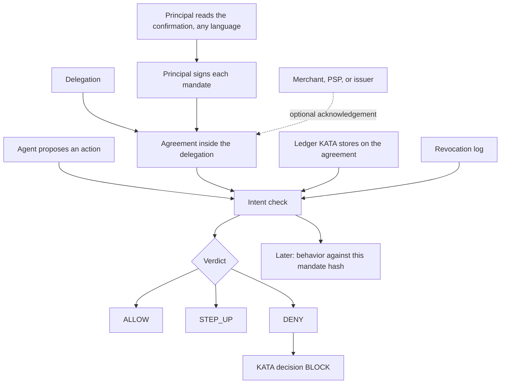
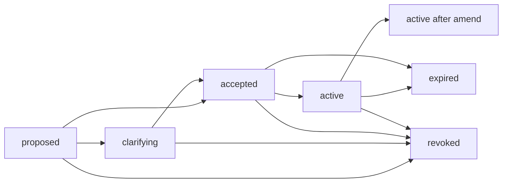

# KATA Intent Agreement

**Status: Concept / Open Design — not production ready.**

This document specifies how a principal and an agent, and optionally a merchant, a payment provider, or an issuer, establish a verifiable agreement on what the agent may do, and how a proposed action is checked against that agreement.

It is the machinery for KATA's third question: **what was the agent authorized to do?** The fourth question — whether behavior matches that authorization — consumes the same signed record later. This document does not score behavior, and it does not replace the seven-outcome decision in [schemas/decision.json](../schemas/decision.json).

KATA's own objects are authoritative here. AP2 mandates, Verifiable Intent credentials, and OAuth or GNAP grants are evidence that can be mapped into these objects. Field mapping for the commerce mandates stays in [interoperability.md](interoperability.md).

## Decisions

Kaan answered the open questions. The agreement lives inside the delegation, KATA holds the spend ledger, and one delegation may carry several live intents as long as they stay inside the parent set. The table is the source for those choices. A short answer that could be read more than one way has its interpretation in the last column.

| # | Question | Decision | How it is applied |
|---|---|---|---|
| 1 | Should the signed agreement stay beside the delegation, or go inside it? | Include it inside ("içine girsin"). | `delegation.intent_agreement` holds the agreement. `Agreement.to_delegation()` writes it there. Evaluating a delegation uses that record and checks the delegation scope. |
| 2 | Is `maximum_amount` the per-transaction ceiling, with the cumulative cap kept separate? | Keep the total limit tracked separately. | `maximum_amount` stays per transaction. `limits.cumulative_maximum` is that intent's slice. `parent_limits.cumulative_maximum` is the total for the delegation. |
| 3 | Who holds the spend ledger, and is a missing total a step-up or a rejection? | KATA will hold it; reject ("Kata tutacak, red"). | The agreement's `ledger` starts empty, which means nothing has been spent. `record_allowed` appends charges. If a cumulative or frequency limit is signed and the ledger field is missing, the verdict is `DENY`. |
| 4 | Is the principal's signature enough to activate, without a counterparty countersignature? | That is sufficient. | Default `required_acknowledgements` is empty. A countersignature is required only when the mandate names that role. |
| 5 | Should a missing expiry or a missing ceiling hard-deny, or ask for approval? | It should ask for approval. | `OVER_BROAD_INTENT` is `STEP_UP` with `required_action` `HUMAN_APPROVAL`. |
| 6 | Major units and Ed25519, or minor units and ES256 so the principal signs an AP2 or Verifiable Intent payload? | "I will sign it." | **Interpretation.** The principal signs the KATA mandate. Version 1 stays major units and Ed25519. The signed payload does not switch to minor units or ES256. |
| 7 | Must every payment step up until a revocation endpoint is checked, even when the mandate names none? | It should drop ("düşsün"). | **Interpretation.** Do not step up only because no endpoint is named. When an endpoint is named and the caller has not checked it, `ALLOW` drops to `STEP_UP` / `REVOCATION_ENDPOINT_UNCHECKED`. That miss is not, by itself, a `DENY`. |
| 8 | May anyone other than the signing principal revoke? | No. | `revoke` accepts only the principal key that signed the mandate. |
| 9 | Does a price or fee miss block the charge without revoking the grant? | Correct. | Those reason codes are `DENY` with `required_action` `NONE`. The mandate stays active. |
| 10 | Should `P1M` be a calendar month instead of 30 days? | No. | `P1M` remains thirty days. |
| 11 | Must the signed confirmation be the English rendering? | Any language may be used. | **Interpretation.** The signer may supply the confirmation text. The signature covers that text, and the verifier checks that `rendering.hash` is the SHA-256 of `rendering.text`. The text does not have to equal the English renderer. When no text is supplied, the English renderer is what gets signed. An unsigned translation has no force. |
| 12 | One live intent per agreement, or several? | Several. | `mandates` is a list. `add_intent` appends another signed intent. With more than one live intent, the action must name `intent_id`. Otherwise the verdict is `STEP_UP` / `INTENT_NOT_SELECTED`. |
| 13 | Must an asserted or added intent equal the parent, or may it be a subset? | Subsets are accepted, but a subset must not exceed the parent set's volume. | **Interpretation.** A child may be narrower. Each child's per-transaction ceiling is at most the parent's. Each child's cumulative slice is at most the parent's cumulative cap, and the sum of the live slices is at most that cap. Per-transaction ceilings are not added together. Allowed actions must be a subset. A merchant list must be a subset when the parent names merchants. Expiry must not be later. Category, currency, and purpose must match. The same subset rule applies to an asserted intent. A higher amount, an extra verb, or a later expiry is `ASSERTED_INTENT_MISMATCH`. |

The structured intent stays [schemas/intent.json](../schemas/intent.json). Delegation stays the answer to who authorized the agent ([delegation-model.md](delegation-model.md)). Amounts stay major units (`1500`, not `150000` cents). Version 1 signs with Ed25519, carried as a flattened JWS (`alg: EdDSA`). The check returns `ALLOW`, `STEP_UP`, or `DENY`. `DENY` is the KATA decision `BLOCK`. `REVOKE` and `QUARANTINE` stay decisions of the wider engine, or an explicit signed revocation by the principal.

## Where it sits



The intent module in [architecture.md](architecture.md) is this check plus the store of mandates. The reference library is the check and the lifecycle, in process. It is not the gateway, and it does not open a network connection.

## Data model

### Intent mandate

Schema: [schemas/intent-mandate.json](../schemas/intent-mandate.json).

| Field | Role |
|---|---|
| `mandate_id`, `version` | Identity of this version. An amendment gets a new id and the next version. |
| `supersedes` | Hash of the signing document of the version it replaces. |
| `principal` | `type` and `id`, as on a delegation, plus the Ed25519 public JWK once signed. `display_name` is signed when present. |
| `agent` | `agent_id`, the public JWK, and `public_key_fingerprint`. The fingerprint is SHA-256 over the raw 32-byte public key, lowercase hex, prefixed `sha256:`. |
| `delegation_id` | The Q2 grant this mandate belongs to, when there is one. |
| `intent` | A [KATA intent](../schemas/intent.json). `maximum_amount` is the per-transaction ceiling. |
| `limits` | This intent's cumulative slice, frequency, merchant denylist, and a restatement of the per-transaction ceiling. See below. |
| `parent_limits` | The parent set signed into every live mandate: per-transaction cap, cumulative total, currency, and the scope the children must stay inside. |
| `not_before`, `expires_at` | The window. When `intent.time_limit` is also set, it is the same instant as `expires_at`. |
| `required_acknowledgements` | Roles that must countersign before the agreement is active: `agent`, `merchant`, `psp`, `issuer`. |
| `revocation_endpoint` | Where revocation is published. The reference library does not fetch the URL. |
| `rendering` | The confirmation text, in any language, and its SHA-256. Both are inside the signature. |
| `signature` | Flattened JWS over the signing document. |

The signing document is those fields except `signature`, plus `"kata_mandate": "1"`. The JWS protected header is `{"alg":"EdDSA","kid":"<fingerprint>","typ":"kata-mandate+jws"}`. Header and payload are both canonical JSON.

`limits.per_transaction_maximum`, when present, equals `intent.maximum_amount`. It is a restatement so a reader of the agreement sees the ceiling next to the cumulative cap. It is not a second, looser ceiling.

`limits.cumulative_maximum` is this intent's slice of the parent total, in `limits.currency` (the intent currency). It is not the per-transaction ceiling. The parent total is `parent_limits.cumulative_maximum`. The sum of the live slices must not exceed that total. Per-transaction ceilings are not added together.

`limits.frequency` is `{max_count, per}`. `per` is `agreement` (the whole window), `P1D` (one day), `P7D` (seven days), or `P1M` (thirty days, not a calendar month).

`limits.merchant_denylist` refuses merchants even when `intent.merchant_constraints` is empty. An empty `merchant_constraints` array still means no allowlist, as in the intent schema.

### Agreement record

Schema: [schemas/agreement.json](../schemas/agreement.json).

| Field | Role |
|---|---|
| `agreement_id` | Stable id across versions. |
| `status` | `proposed`, `clarifying`, `accepted`, `active`, `revoked`, `expired`. Advisory. The evaluator does not treat the word `active` as authority. |
| `mandates` | The live signed intents. One agreement may hold several. |
| `parent_limits` | The parent set. Each live intent carries the same object inside its signature. |
| `ledger` | Charges KATA has recorded. Empty means nothing has been spent. Absent means the total is unknown, and evaluation denies. |
| `mandate_history` | Superseded versions, retained. |
| `acknowledgements` | Countersignatures of a mandate hash. |
| `revocation` | A signed revocation, when the record still contains it. |
| `events` | The audit log. |
| `created_at`, `updated_at` | Informational. Not signed. |

An acknowledgement is a JWS (`typ: kata-ack+jws`) over `kata_ack`, `agreement_id`, `mandate_hash`, `role`, `id`, `at`, and the acknowledging public key. An agent acknowledgement must use the key named in the mandate. A merchant, PSP, or issuer acknowledgement proves that the holder of the embedded key saw this mandate hash. It does not, by itself, prove the key belongs to that institution. Binding institution keys is an open question.

A revocation is a JWS (`typ: kata-revocation+jws`) over `kata_revocation`, `agreement_id`, `mandate_hash`, `at`, and `reason`. The reference implementation accepts a revocation only from the principal key that signed the mandate.

### Canonical JSON

Signatures are over UTF-8 JSON with:

- object keys sorted by UTF-16 code units
- no insignificant whitespace
- strings escaped as JSON, and U+2028 / U+2029 escaped as well
- numbers in base 10, no exponent, no leading zero, no trailing fractional zero, and no decimal point when the value is an integer

`1`, `1.0`, and `1.00` are the same amount and encode as `1`. `1.50` encodes as `1.5`. Non-finite numbers are rejected. This is the RFC 8785 shape for the types the library emits. A language-default serializer that writes `1.0` will not verify.

### What the signature does not cover

The event log, the spend ledger, `status`, `created_at`, and `updated_at` are outside the mandate signature. KATA's copy of the ledger is the one evaluation uses. A shortened copy is not detected yet. Each event stores `event_hash`, the SHA-256 of the canonical event with that field removed, and `prev_event_hash` of the previous event. An edit in the middle no longer matches.

That chain does not stop the holder of the file from dropping the tail and keeping an older prefix: the prefix still hashes. A verifier that has stored a previous head can pass it as `expected_log_head` and detect the drop. A verifier that has not seen the log before cannot.

Revocation distribution is the control for that gap, not the hash chain. See [Threats](#threats).

## Human-readable rendering

The hardest fraud problem at grant time is a principal signing limits they did not read, or reading a sentence the agent rewrote. The confirmation text is part of the signed document, in whatever language the principal was shown. The reference renderer produces a fixed English sequence from the structured fields, and that text is what gets signed when the caller does not supply one. Verifiers do not retranslate. They check that `rendering.hash` is the SHA-256 of the signed `rendering.text`. A text whose hash does not match does not verify. An unsigned translation has no force.

Whitespace inside the quoted instruction is collapsed to single spaces, so a newline in the source cannot push the ceilings below a one-line display.

For the laptop instruction the renderer produces:

```text
You (K. Uluer, usr_9182) authorize agent shopper-01 to purchase.
Agent key: sha256:<fingerprint of the bound agent>.
Your words: "Find and buy a laptop for me, maximum CAD 1,500.".
Up to 1500 CAD per transaction.
Up to 1500 CAD in total under this agreement.
Category: electronics.
Merchants allowed: any.
Allowed actions: search, compare, purchase.
Valid from 2026-10-04T13:55:00Z until 2026-10-10T23:59:59Z.
Delegation: dlg_77.
The agent cannot change these limits. You can revoke this agreement.
```

`accept`, `amend`, and `add_intent` take `rendering_text` for that confirmation. `confirmed_text`, when passed, must equal the text about to be signed. The English line order is the default for `kata_mandate` version `1`, not the only legal text. Who must display the confirmation (wallet, AI application, merchant) is still open.

## Lifecycle



| Step | Who | What is recorded |
|---|---|---|
| Propose | Agent, principal, or a policy actor | Unsigned draft. Event `proposed`. |
| Clarify | Any party | The draft is replaced. Event `clarified`. Status `clarifying`. Nothing is signed yet, so a clarification cannot widen a grant that does not exist. |
| Accept | Principal, with the principal's key | Rendering and Ed25519 signature. Event `accepted`. If every required acknowledgement is already present, event `activated` and status `active`. Otherwise status `accepted`. |
| Acknowledge | Agent, merchant, PSP, or issuer | Countersignature of the current mandate hash. Event `acknowledged`. The agreement becomes `active` when the required roles are covered. |
| Amend | Principal | New version of one live intent, previous version moved to history, acknowledgements of that hash dropped. Event `amended`. The old hash no longer authorizes an action. The amended intent must still fit the parent set. |
| Add intent | Principal | Another live mandate under the same parent set. Event `added`. Rejected when the per-transaction ceiling, the cumulative slice, or the sum of slices would exceed the parent. |
| Revoke | Principal | Signed revocation. Event `revoked`. Status `revoked`. The revocation object is also returned so a log outside the agreement can store it. |
| Expire | Time | Evaluation denies once `now` or the action time is past the window, even if nobody has written an `expired` event. `expire` records the event when called after the window. |

Renewal is a new grant or a new version. It is not a silent extension of `expires_at`.

Default required acknowledgements are none. The principal's signature plus the bound agent key is enough to become active. Requiring an agent countersignature, or a merchant or issuer acknowledgement, is a field on the mandate (`required_acknowledgements`), so stripping it breaks the signature.

## Verification

```text
evaluate(agreement or mandate, action) -> ALLOW | STEP_UP | DENY
```

Inputs beyond the action:

| Input | Why |
|---|---|
| Principal public key the verifier expects | The embedded JWK only proves the signature matches itself. Passing the expected key binds it to the principal the verifier already knows. Omitting it is `STEP_UP` / `PRINCIPAL_KEY_UNBOUND`. |
| Agent id and agent public key | Checked against the bound agent. |
| Ledger of prior charges | KATA stores this on the agreement. Omit the argument to use that record. `[]` means nothing has been spent. A missing ledger field, when a cumulative or frequency limit is signed, is `DENY`. |
| `now` | The verifier's clock. Expiry is enforced here, not only at issuance. |
| `seen_action_ids` | Replay of an action id. |
| `extra_revocations` | Signed revocations from a log the verifier trusts. |
| `expected_log_head` | A log head the verifier has seen before. |
| `revocation_checked` | Caller affirms it consulted `revocation_endpoint`. |
| `delegation` | Optional Q2 cross-check: status, expiry, intent id, ceiling, verbs, agent, principal. |
| `asserted_intent` | An intent the agent claims, including one stuffed into `action.parameters.asserted_intent`. |

The signature is checked first. If it fails, the result is `DENY` and the other fields are not interpreted. A tampered ceiling must not produce a tidy "amount exceeded" reason about attacker-controlled numbers.

When the signature holds, every other check runs. A `DENY` reason wins over a `STEP_UP` reason. Both are returned, deny codes first, so the principal sees the whole set.

| Verdict | KATA `decision` | `required_action` |
|---|---|---|
| `ALLOW` | `ALLOW` | `NONE` |
| `STEP_UP` | `STEP_UP` | `STEP_UP`, or `HUMAN_APPROVAL` when the reason is `OVER_BROAD_INTENT` |
| `DENY` | `BLOCK` | `HUMAN_APPROVAL` when every deny reason is a limit the principal could widen on purpose (amount, merchant, category, frequency, cumulative, a verb). `NONE` when the failure is integrity, revocation, expiry, replay, a price or fee miss, or a bad key. |

There is no risk score. The decision schema's score is a different layer, and this library will not invent one.

### Reason codes

Integrity and authority, all `DENY`:

| Code | When |
|---|---|
| `MANDATE_SIGNATURE_INVALID` | Missing or bad signature. |
| `MANDATE_TAMPERED` | The signed bytes and the mandate fields differ. |
| `MANDATE_NOT_ACTIVE` | The principal has not signed. |
| `PRINCIPAL_KEY_MISMATCH` | The expected principal key is not the signing key. |
| `RENDERING_MISMATCH` | The stored confirmation is empty, or its hash is not the SHA-256 of that text. The text may be any language. |
| `AGREEMENT_LOG_TAMPERED` | The event chain, a pinned head, or a revocation marker does not verify. |
| `AGREEMENT_MALFORMED` | The object is neither a mandate nor an agreement. |
| `MANDATE_REVOKED` | A valid principal revocation for this agreement and this mandate hash. |
| `MANDATE_EXPIRED` | `now` or the action time is past the window. |
| `MANDATE_NOT_YET_VALID` | The action is before `not_before`. |
| `WINDOW_INCONSISTENT` | `expires_at` and `intent.time_limit` disagree. |
| `ACK_SIGNATURE_INVALID`, `ACK_KEY_MISMATCH` | A countersignature on the current hash is bad, or the agent used the wrong key. |

Scope, `DENY` unless noted:

| Code | When |
|---|---|
| `ACTION_NOT_ALLOWED`, `ACTION_EXCEEDS_INTENT` | The verb is outside `allowed_actions` or the delegation's verbs. The amount codes also add `ACTION_EXCEEDS_INTENT`, which is the code the shopping-agent example already uses. |
| `AMOUNT_ABOVE_INTENT_CEILING` | Above `maximum_amount` or the delegation ceiling. |
| `CUMULATIVE_LIMIT_EXCEEDED` | Prior counted charges plus this amount exceed `cumulative_maximum`. |
| `FREQUENCY_LIMIT_EXCEEDED` | The window already holds `max_count` counted charges. |
| `CURRENCY_MISMATCH` | Action, intent, delegation, or ledger currency disagree. No conversion is attempted. |
| `MERCHANT_NOT_ALLOWED` | Misses a non-empty allowlist, or hits the denylist. |
| `CATEGORY_MISMATCH` | The action states a category and it is not the intent category. An action that states no category is not failed for that alone. |
| `COUNTERPARTY_NOT_ALLOWED` | Merchant id or settlement address outside the signed lists. |
| `SETTLEMENT_ADDRESS_MISMATCH` | `settlement_address` and `registered_settlement_address` are both present and differ. |
| `COUNTERPARTY_RISK_EXCEEDED` | Observed risk is above `counterparty_constraints.maximum_risk`. |
| `CONSTRAINT_VIOLATED` | `parameters.quantity` is above `constraints.max_items`. Other constraint keys are carried and not interpreted. |
| `CHARGE_EXCEEDS_QUOTE`, `CHARGE_EXCEEDS_LISTED` | Charge is above the reference times `tolerance_ratio`. The comparison is `charge <= reference * tolerance`. Equality with the quote is not the test. |
| `UNDISCLOSED_FEE` | A non-item line is not disclosed, and `allow_undisclosed` is false. A missing `disclosed` flag counts as not disclosed. |
| `FEE_NOT_ACCEPTED` | A non-item fee code is outside `allowed_codes`. |
| `DELEGATION_NOT_ACTIVE`, `DELEGATION_SCOPE_MISMATCH`, `PRINCIPAL_MISMATCH` | Only when the caller passes a delegation. |
| `AGENT_BINDING_MISMATCH` | The acting agent or key is not the bound one. |
| `ASSERTED_INTENT_MISMATCH` | The agent asserted a wider intent than the one the principal signed: a higher amount, a later expiry, an extra verb, a merchant outside a named allowlist, or a different category, currency, or purpose. A narrower amount, a shorter action list, or an earlier expiry is allowed. |
| `INTENT_UNKNOWN` | The action names an `intent_id` that is not live. |
| `LIMIT_INCONSISTENT` | Signed limits disagree, or a live intent allocates more than the parent set. |
| `MANDATE_SUPERSEDED` | The action names a mandate hash that is not the current version. |
| `ACTION_REPLAY` | The action id was already seen or is in the ledger, or the idempotency key was already used for a charge whose outcome was not `failed`. |
| `RETRY_FARMING` | `settlement.prior_attempt_status` is `settled`. A prior status of `failed` is not this code. |
| `CUMULATIVE_STATE_UNAVAILABLE`, `FREQUENCY_STATE_UNAVAILABLE` | That limit is signed and the agreement has no ledger. An empty ledger is zero spent, not this code. |
| `ACTION_MALFORMED`, `LEDGER_MALFORMED` | The action or a ledger entry cannot be read safely. |
| `ACTION_TIME_IN_FUTURE` | The action time is more than the skew (default 120 seconds) ahead of `now`. |

`STEP_UP`:

| Code | When |
|---|---|
| `PRINCIPAL_KEY_UNBOUND` | Signature matches the embedded key, and the caller did not pass the principal key it expects. |
| `OVER_BROAD_INTENT` | A money purpose has no ceiling, or there is no expiry, or there are no allowed actions. `required_action` is `HUMAN_APPROVAL`. A policy may also flag a high ceiling with no category and no merchant; that threshold is off unless the caller sets it. |
| `INTENT_NOT_SELECTED` | More than one intent is live and the action does not name `intent_id`. The library does not pick one. |
| `COUNTERPARTY_ACK_REQUIRED` | A required acknowledgement for the current hash is missing. |
| `REVOCATION_ENDPOINT_UNCHECKED` | The mandate names an endpoint and the caller has not set `revocation_checked`. |
| `AMOUNT_NOT_PROVIDED` | A money action, or an action under a price expectation, has no amount. |
| `TOLERANCE_NOT_DECLARED` | A quote or list is signed and `tolerance_ratio` is absent. The library will not assume `1`. |
| `COUNTERPARTY_RISK_UNKNOWN` | The mandate caps counterparty risk and the action has no `low` / `medium` / `high` risk. |

Ledger outcomes `allowed`, `authorized`, and `settled` count toward cumulative and frequency. `failed` does not. A price check runs only when the intent has `price_expectation`. A ceiling is never copied into `quoted_price`.

An action inside the window is not failed for being old. Replay is an id and an idempotency key, not a second look at the clock.

## Threats

These sit under the assets already named in [threat-model.md](threat-model.md): intent objects, delegation records, and the decision trail. The rows below are the ones this design takes a position on.

| Threat | What the agreement does |
|---|---|
| **Prompt injection that widens scope** | The evaluator reads the signed mandate, not an intent in the tool output. A narrower asserted intent is allowed. A wider one is `DENY` / `ASSERTED_INTENT_MISMATCH`. The agent has no key that can amend the mandate or raise the parent set. |
| **Mandate tampering** | Any change to a signed field, including the rendering, fails verification before amount checks run. |
| **Replay** | A repeated action id, or an idempotency key already used for a non-failed charge, is `ACTION_REPLAY`. A settled attempt that is charged again is `RETRY_FARMING`. A retry after `failed` is not. |
| **Over-broad intent** | Missing expiry, missing ceiling on a money purpose, or missing verbs is `STEP_UP` / `OVER_BROAD_INTENT`, with `HUMAN_APPROVAL`. The default does not invent a currency-blind amount threshold. Empty merchant constraints remain "no allowlist", which is a real choice the rendering states as "Merchants allowed: any." |
| **Signing what you did not read** | The words the principal was shown are inside the signature, in whatever language was shown, and tied to the agent key fingerprint. The verifier checks the hash of those words. It does not accept a different translation. A swapped agent key changes the default English sentence. |
| **Approval fatigue** | A quote, list, or undisclosed-fee miss is `DENY` with `required_action` `NONE`. The principal is not asked to rubber-stamp the same charge. Widening the grant is an amendment, which produces a new rendering. |
| **Revocation stripped from the copy the agent shows** | A revocation inside the record is enough to deny. Absence is not enough to allow. Verifiers pass `extra_revocations` from a log they trust, or pin `expected_log_head`. If the mandate names `revocation_endpoint`, evaluation steps up until the caller says that endpoint was checked. A mandate that names no endpoint does not step up for that reason. The library does not fetch the endpoint. Short expiry bounds the window in which a missed revocation still works. |
| **Self-signed principal key** | Verification against the embedded JWK proves the signature matches that key. It does not prove the key is the human. `PRINCIPAL_KEY_UNBOUND` steps up until the verifier supplies the key it already associates with the principal. WebAuthn and verifiable credentials remain the way that association is made. |
| **Counterparty overcharge** | Quote, list, and fee checks can `DENY` the action. They do not revoke the mandate. |
| **Honest price movement** | A tolerance band is required before a quote is compared. The band is the one the principal signed for this intent. |

Upstream account takeover of the AI application is unchanged from the threat model: a real principal key can sign a real mandate for the attacker's purchase. This layer will show a valid signature. Per-session step-up to the human is still the control, and it belongs to the wider decision, not to a second copy of the mandate.

## Interoperability

KATA does not adopt AP2, Verifiable Intent, OAuth, or GNAP as the mandate format. A verified credential is evidence. The intent check still runs, and its verdict is a KATA verdict.

| Source | What it can fill | What it does not decide |
|---|---|---|
| **AP2 v0.2** open mandate plus a closed mandate that satisfies it | Principal and agent keys, `maximum_amount` from `payment.amount_range.max` after minor-to-major conversion, merchant and payee lists, `expires_at` from `exp`. Cumulative `payment.budget` maps to `limits.cumulative_maximum`, not to `maximum_amount`. | Behavior, quote versus charge, the seven decisions. AP2 receipts accept or reject a mandate. |
| **Verifiable Intent** autonomous chain | Same shape: L2 constraints become the intent, L2 `cnf` is the agent key, L2 `exp` is the window. `mandate.payment.budget` is the cumulative cap. | Same gaps. VI's checker is pass or violation. |
| **OAuth 2.0** | A token is delegation evidence (Q2), the way [standards.md](../research/standards.md) already says. A scope string is not an intent. | Amount, merchant, price, revocation of a KATA mandate. |
| **RFC 9396 Rich Authorization Requests** | `authorization_details` can *carry* a KATA intent object as a JSON value. The type URI would be KATA's, and the schema would stay this one. | RAR does not define the check. |
| **GNAP (RFC 9635)** | The negotiate-then-grant loop is the same shape as clarify then accept. A GNAP access token can be delegation evidence. Subject identifiers can name the principal. | GNAP access rights are resource descriptors. They are not a ceiling, a tolerance band, or a behavior hook. |
| **W3C Verifiable Credentials** | A natural later envelope for the same signing document, once the fields are stable. Agent badges remain Q1 evidence. | This version does not wrap the mandate in a VC. |
| **Visa Trusted Agent Protocol, Web Bot Auth** | Q1, the agent key. | No purchase constraints. |

Two conversions that are easy to get wrong, and that this spec does not do:

- Do not map an amount ceiling onto `price_expectation.quoted_price`.
- Do not treat an AP2 or VI minor-unit integer as a KATA major-unit amount.

Worked mappings of the commerce fields remain [interoperability.md](interoperability.md). The reference library does not parse an AP2 JWS or an SD-JWT.

## Reference implementation

[`reference/python`](../reference/python) is a Python library. Tests cover signing, tampering, the lifecycle, the laptop amounts, price and fees, cumulative and frequency state, replay, revocation stripping, and schema validation. `examples/purchase_check.py` signs the CAD 1,500 laptop intent, allows a CAD 1,300 purchase, denies a CAD 4,200 purchase, then revokes and denies the in-scope purchase.

| Implemented | Stubbed or absent |
|---|---|
| Create, render, sign, and verify a mandate | Natural-language parsing into an intent. The caller supplies the structured intent. |
| Propose, clarify, accept, acknowledge, amend, add an intent, revoke, expire | An HTTP API, a gateway, or storage shared across processes |
| `ALLOW` / `STEP_UP` / `DENY` with the reason codes above | Risk scores, behavior profiles, drift across a session |
| Spend ledger stored on the agreement, and a deny when that ledger is missing | A ledger head that would catch a shortened copy, and sync across processes |
| Revocation signatures, an external revocation list, a pinned log head, step-up when a named endpoint was not checked | Fetching the endpoint, pushing revocation, a transparency log |
| Price band, fees, merchant, category, settlement mismatch, `max_items` | A general constraint language. Other `constraints` keys are stored only. |
| Agreement stored inside the delegation, and a scope cross-check | Walking an agent-to-agent delegation chain |
| Ed25519 JWS over major units, signed by the principal | ES256, SD-JWT, selective disclosure |
| Confirmation text in any language, with the English renderer as the default | A component that is responsible for displaying that text |

Demo keys in the example are derived from public seeds.

## Roadmap

The next slices, in the order they unblock each other:

1. **Revocation status.** A signed log a merchant or issuer can query, with a freshness bound. The endpoint field and `extra_revocations` are the hook. Fetching and caching are not done.
2. **Ledger freshness.** KATA holds the total on the agreement, and a missing ledger denies. What remains is detecting a shortened copy, and how stale a replica may be before a verifier stops trusting it.
3. **Full evaluator.** Identity, delegation freshness, and behavior around this verdict, emitting the seven decisions. Still no calibrated score until there is a measurement.
4. **Intent capture.** Propose a structured intent from the instruction, then require the rendering as the confirmation. The parser is a separate component so a bad parse cannot sign itself.
5. **Algorithm agility.** ES256 as a second JWS algorithm so a Verifiable Intent key can countersign without a bridge. Version the signing document rather than overloading `kata_mandate` `1`.
6. **Counterparty profiles.** When a payment requires a merchant, PSP, or issuer acknowledgement, and how those keys are pinned.
7. **Evaluation against AgentCommerceBench.** Run the reference check on the classes it can see (amount, category, quote, list, fees, replay, payee). Report recall at a stated false-positive budget. Do not cite a coverage number before that run. Silent downgrade still needs delivery evidence this layer does not have.
8. **Envelope.** Only after the fields settle: VC packaging, or carrying the intent inside RAR `authorization_details`. Not a second schema.

## Still open

The thirteen questions above are decided. These are not:

- Which component shows the confirmation text to the principal.
- How a verifier detects a shortened copy of the ledger KATA holds, and how stale a replica may be. The in-record list is the reference store. It is not yet shared across processes, and it has no pinned head.
- Whether `INTENT_NOT_SELECTED` stays the right response when several live intents match and the action names none. The library steps up rather than choosing an intent for the agent.
- Fetching a revocation endpoint, pushing revocation, and a transparency log. Naming no endpoint does not force a step-up. Distribution is still unbuilt.
- A currency-blind ceiling for "any merchant, any category". The policy knob exists and is off.
- How a merchant, PSP, or issuer acknowledgement key is pinned to that institution.
